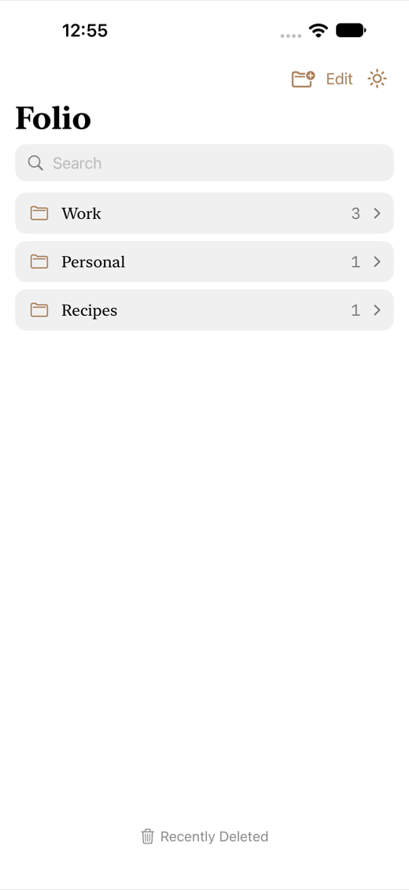
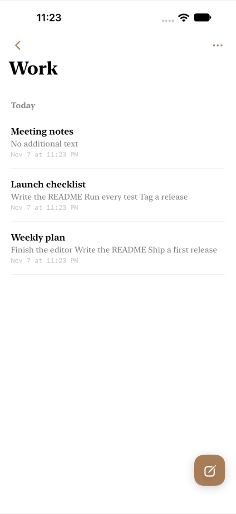
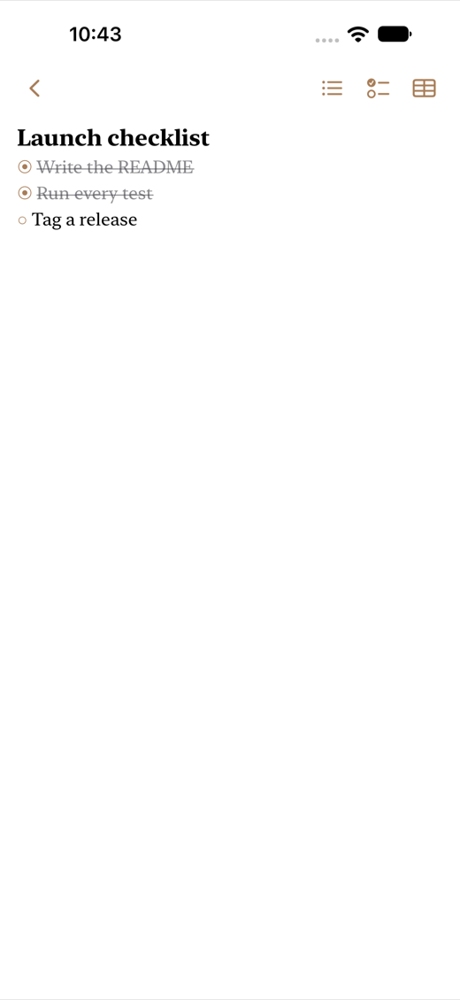
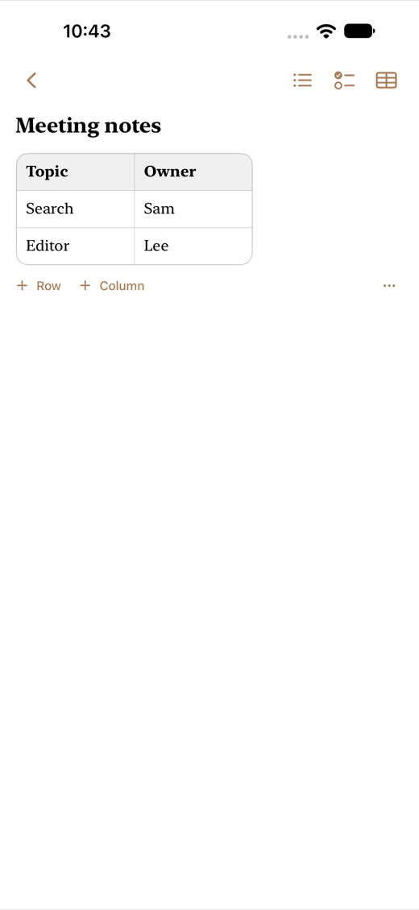
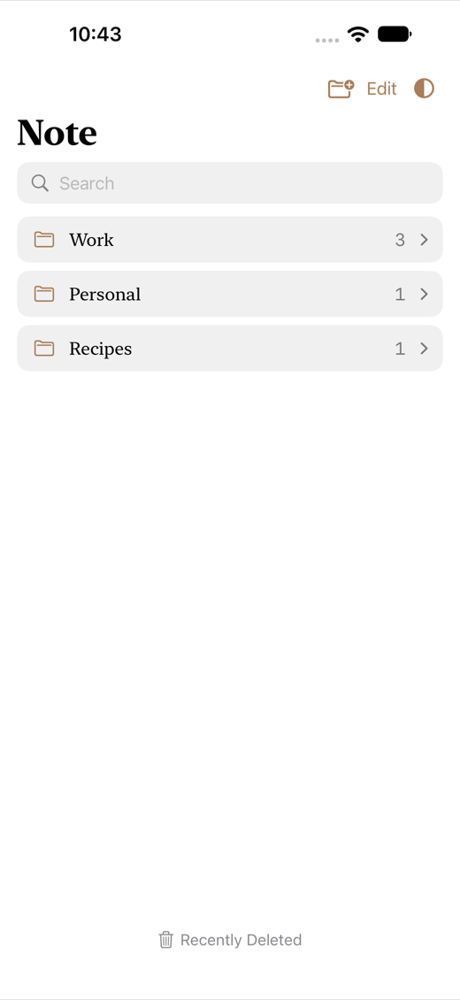

# Note

A fast, quiet notes app for iPhone. Everything stays on the phone. Built with SwiftUI and SQLite.

## Why

Other note apps kept getting in the way.

| What went wrong | What Note does |
| --- | --- |
| Sync that fails or conflicts | No sync and no account. Notes live on the phone |
| Hard to keep tidy | One level of folders, notes sorted by last change, drag to reorder |
| Slow to find things | Search matches any part of a word, in folders and in notes |
| Cluttered screens | White or black, one header per screen, a little brown |

## Features

- **Folders, one level deep.** The main screen is only folders. Tap one to see its notes.
- **Notes sorted by last change.** Pinned, Today, Last 7 Days, Last 30 Days, then months, then years.
- **First line is the title.** Bold and larger. Everything below is the note.
- **Bullets, checklists, tables.** Return continues a list, Return on an empty item ends it, tap a circle to check it off.
- **Forgiving search.** `est`, `3`, `test` and `TEST` all find `Test3`. Folders and notes.
- **Recently Deleted.** Deleted notes wait here. Restoring asks which folder, or lets you make one.
- **Edit mode.** Select many to delete or move, drag folders into order.
- **Light or dark.** One icon flips between them. The first launch follows the phone.
- **Autosave.** A note opened and left empty is removed.

## Screenshots

| Folders | Notes by date | Checklist | Table | Dark |
| :---: | :---: | :---: | :---: | :---: |
|  |  |  |  |  |

## Using it

| To do this | Do this |
| --- | --- |
| Make a folder | Folder icon, top right of the main screen |
| Write a note | Open a folder, brown button bottom right |
| Add a list or table | Icons at the top right of a note |
| Check something off | Tap its circle |
| Pin, move or duplicate a note | Press and hold it. Swipe right to pin |
| Delete a note | Swipe left. It goes to Recently Deleted |
| Rename, duplicate or delete a folder | Press and hold it |
| Reorder folders | Edit, then drag the handles |
| Delete or move many | Edit, tick items, then Delete or Move |
| Get a note back | Recently Deleted (bottom of the main screen), swipe right, pick a folder |
| Switch light and dark | Sun or moon icon next to Edit |
| Find anything | Search field on the main screen |

## Run it

Needs Xcode (iOS 17 SDK or newer) and [XcodeGen](https://github.com/yonaskolb/XcodeGen). The Xcode project is generated from `project.yml`, so it is not checked in.

```bash
git clone https://github.com/sungwoonpk/Note-App.git
cd Note-App
brew install xcodegen
xcodegen generate
open Notes.xcodeproj
```

Pick an iPhone simulator and press Run. The only dependency, [GRDB](https://github.com/groue/GRDB.swift), is fetched on first build.

## Tests

```bash
# Logic: storage, search, trash, documents. No simulator needed
cd Packages/NoteCore && swift test

# The real app, driven through its screens
xcodebuild -project Notes.xcodeproj -scheme Notes \
  -destination 'platform=iOS Simulator,name=<an installed iPhone>' test
```

- **Unit tests:** storage, search, odd queries, huge notes, 25 saves at once, midnight boundaries, migrations.
- **UI tests:** every main flow plus awkward ones: blank and very long names, empty notes, deleting every folder, restoring with no folder left, closing and reopening the app.
- **Isolation:** UI tests launch with `-ui-testing`: in-memory database, phone's light/dark mode. `-ui-testing-db <path>` uses a file for tests that relaunch.
- **Screenshots:** `TEST_RUNNER_SCREENSHOT_DIR=docs/screenshots xcodebuild ... -only-testing:NotesUITests/ScreenshotTests test`

## Repo structure

```
Note-App/
├── App/                       SwiftUI app
│   ├── NotesApp.swift         Entry point, colors, fonts
│   ├── RootView.swift         Split view and navigation stack
│   ├── HomeView.swift         Folders, search, Edit, Recently Deleted button
│   ├── FolderScreen.swift     One folder's notes, grouped by date
│   ├── EditorView.swift       Editor: loading, autosave, header buttons
│   ├── NoteTextView.swift     Text runs: title, bullets, checklists
│   ├── TableBlockView.swift   Editable table
│   ├── TrashScreen.swift      Recently Deleted
│   ├── AppModel.swift         State and actions
│   └── Components.swift       Header, buttons, rows, folder picker
├── Packages/NoteCore/         Everything that is not UI (Swift package)
│   ├── Sources/NoteCore/
│   │   ├── Models.swift       Folder, Note, Block
│   │   ├── AppDatabase.swift  SQLite schema and migrations
│   │   ├── NoteStore.swift    Every read and write
│   │   ├── NoteDocument.swift Note text <-> blocks
│   │   ├── NoteGrouping.swift Today, Last 7 Days, months, years
│   │   └── FolderSearch.swift Folder names, any part, any case
│   └── Tests/NoteCoreTests/   Unit tests
├── UITests/                   Tests that drive the real app
├── docs/screenshots/          Images for this README
└── project.yml                XcodeGen project definition
```

## How it works

- **Two layers.** `NoteCore` has no UI and is tested without a simulator. `App` draws and calls `NoteStore`.
- **Storage.** SQLite through GRDB. Tables `folder`, `note`, `block` and a search index. Changes ship as numbered migrations, so old data carries forward.
- **Note content.** A note is blocks: `text`, `bullet`, `checklist` (checked ones marked `done`), `table` (cells as JSON). Title and one-line preview are cached on the note, so lists never load bodies.
- **Search.** FTS5 with the trigram tokenizer: any part of a word, any case. Under three characters it falls back to a substring scan. Folder names are matched separately.
- **Editor.** Text runs with tables between them. Each run is a `UITextView` styled as you type. Markers `•` `○` `◉` are what you see and become blocks on save.
- **Load safety.** The editor stays locked until the note has been read, and retries on failure. A failed read can never become an empty note that overwrites the real one.
- **Navigation.** `NavigationSplitView` with a `NavigationStack`. System bars are hidden, each screen draws one header so actions sit together at the top right.

## Design decisions

- **Folders are one level.** Nested trees get confusing. `NoteCore` enforces it, the UI does not just hide it.
- **Notes always live in a folder.** No loose pile to lose track of.
- **A deleted folder is not kept.** Only notes are recoverable, they are what holds content.
- **Local first.** No account, no network. Fast to open, nothing to leak.
- **Plain markers in the text.** Return, backspace and selection behave as people expect, and it still saves as real blocks.

## Status

A working first version for iPhone, in English, tested on iPhone simulators.

**Not done:** sync and sign-in, images, voice notes, numbered lists.
