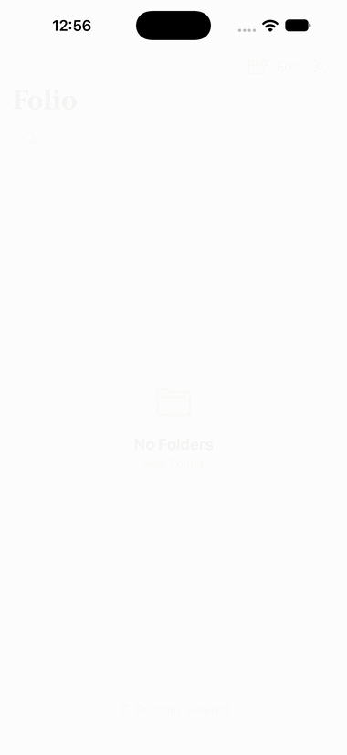

# Folio

[](https://github.com/sungwoonpk/Folio/actions/workflows/ci.yml)

A fast, quiet notes app for iOS. Everything stays on the device. Built with SwiftUI and SQLite.

## Why

I built Folio because I wanted to use it. The note apps I tried kept getting in the way.

| What went wrong | What Folio does |
| --- | --- |
| Sync that fails or conflicts | No sync and no account. Notes live on the device |
| Hard to keep tidy | One level of folders, notes sorted by last change, drag to reorder |
| Slow to find things | Search matches any part of a word, in folders and in notes |
| Cluttered screens | White or black, one header per screen, a little brown |

## Features

- **Folders, one level deep.** The main screen is only folders. Tap one to see its notes.
- **Notes sorted by last change.** Pinned, Today, Last 7 Days, Last 30 Days, then months, then years.
- **First line is the title.** Bold and larger. Everything below is the note.
- **Bullets, checklists, tables.** Return continues a list, Return on an empty item ends it, tap a circle to check it off.
- **Forgiving search.** `est`, `3`, `test` and `TEST` all find `Test3`. Folders and notes.
- **Recently Deleted.** Deleted notes wait here for 30 days. Restoring asks which folder, or lets you make one.
- **Edit mode.** Select many to delete or move, drag folders into order.
- **Light or dark.** One icon flips between them. The first launch follows the system setting.
- **Autosave.** A note opened and left empty is removed.

## Demo

<p align="center"></p>

## Screenshots

| Folders | Notes by date | Checklist | Table | Dark |
| :---: | :---: | :---: | :---: | :---: |
|  |  |  |  |  |

## Using it

| To do this | Do this |
| --- | --- |
| Make a folder | Folder icon, top right of the main screen |
| Write a note | Open a folder, brown button bottom right |
| Add a list or table | Icons at the top right of a note |
| Check something off | Tap its circle |
| Pin, move or duplicate a note | Press and hold it. Swipe right to pin |
| Delete a note | Swipe left. It goes to Recently Deleted |
| Rename, duplicate or delete a folder | Press and hold it |
| Reorder folders | Edit, then drag the handles |
| Delete or move many | Edit, tick items, then Delete or Move |
| Get a note back | Recently Deleted (bottom of the main screen), swipe right, pick a folder |
| Switch light and dark | Sun or moon icon next to Edit |
| Find anything | Search field on the main screen |

## Run it

Needs Xcode (iOS 17 SDK or newer) and [XcodeGen](https://github.com/yonaskolb/XcodeGen). The Xcode project is generated from `project.yml`, so it is not checked in.

```bash
git clone https://github.com/sungwoonpk/Folio.git
cd Folio
brew install xcodegen
xcodegen generate
open Folio.xcodeproj
```

Pick an iOS simulator and press Run. The only dependency, [GRDB](https://github.com/groue/GRDB.swift), is fetched on first build.

## Check it

```bash
cd Packages/NoteCore && swift test
```

That runs the unit tests with no simulator. GitHub Actions runs them and a simulator build on every push and pull request. The UI tests drive the real app, see [testing](docs/testing.md).

## Docs

| Read this | For |
| --- | --- |
| [Architecture](docs/architecture.md) | Repo layout, how storage, search and the editor work |
| [Testing](docs/testing.md) | Unit and UI tests, screenshots and the demo video |
| [Design decisions](docs/decisions/README.md) | Why folders are one level, why trigram search, and more |
| [Changelog](CHANGELOG.md) | What changed, release by release |
